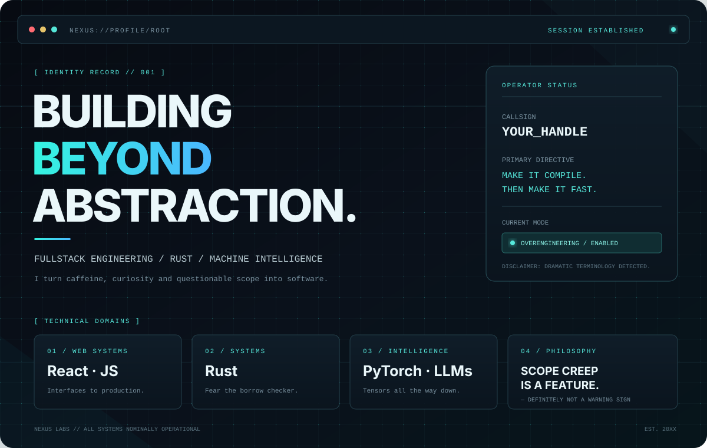

<div align="center">

# ⌬ SYSTEM ONLINE — WELCOME TO MY DOMAIN
</div>
<div align="center">



<br/>

[](https://www.rust-lang.org/)
[](https://react.dev/)
[](https://developer.mozilla.org/en-US/docs/Web/JavaScript)
[](https://pytorch.org/)
[](https://www.kernel.org/)

</div>


<div align="center">


<br/>

**`[ FULLSTACK ]` · `[ RUST ENJOYER ]` · `[ AI / LLM ENTHUSIAST ]`**

*"I don't just write code. I negotiate with machines."*

<br/>

[](https://github.com/)
[](https://www.rust-lang.org/)
[](https://openai.com/)

</div>

---

## `01` — WHOAMI

```rust
struct Developer {
    alias: &'static str,
    role: &'static str,
    specialization: Vec<&'static str>,
    philosophy: &'static str,
}

fn main() {
    let me = Developer {
        alias: "BatmanSR",
        role: "Fullstack",
        specialization: vec![
            "Web Engineering",
            "Systems Programming",
            "Machine Learning",
            "LLM Architecture",
        ],
        philosophy: "If it compiles, it ships.",
    };
}
```

I'm a fullstack developer obsessed with building performant, scalable and occasionally unnecessarily complex systems.

My interests live somewhere between low-level systems engineering, modern web architecture and artificial intelligence.

I enjoy understanding how things work beneath the abstraction layer — and then building another abstraction layer on top of it.

**Current objectives:**
- Architecting modern web applications.
- Exploring the Rust ecosystem and systems programming.
- Experimenting with LLMs, neural networks and model architectures.
- Making JavaScript behave like a respectable programming language.

---

## `02` — TECHNICAL ARSENAL

<div align="center">

### ◈ FRONTEND / WEB ENGINEERING


### ◈ BACKEND / SYSTEMS


### ◈ MACHINE LEARNING / AI


</div>

**Areas of interest**

| Domain | Focus |
|---|---|
| Web Engineering | React, Next.js, TypeScript |
| Systems | Rust, performance, memory safety |
| Backend | APIs, databases, distributed systems |
| AI / ML | PyTorch, neural networks, LLMs |
| Infrastructure | Linux, Docker, deployment |

---

## `03` — CURRENT RESEARCH

research:
  - name: "LLM Systems"
    status: "ONGOING"
    interest: "Understanding intelligence, one tensor at a time."

  - name: "Rust Ecosystem"
    status: "OBSESSION"
    interest: "Zero-cost abstractions. Zero compromises."

  - name: "Fullstack Architecture"
    status: "DEPLOYING"
    interest: "From pixels to production."

  - name: "Neural Networks"
    status: "EXPERIMENTAL"
    interest: "Teaching silicon how to think."


---

## `04` — DEVELOPER PHILOSOPHY

> "Any sufficiently advanced engineering is indistinguishable from overengineering."

- Performance is a feature.
- Abstractions should be earned.
- Memory safety is not optional.
- Documentation is a love letter to your future self.
- If the solution requires 14 microservices, perhaps it requires one function.

---

## `05` — GITHUB ACTIVITY

<div align="center">


</div>

---

<div align="center">

### `END OF TRANSMISSION`


**`[ SYSTEM STATUS: OPERATIONAL ]`**

<sub>Built with power, questionable architectural decisions and an unreasonable amount of Rust.</sub>

</div>
